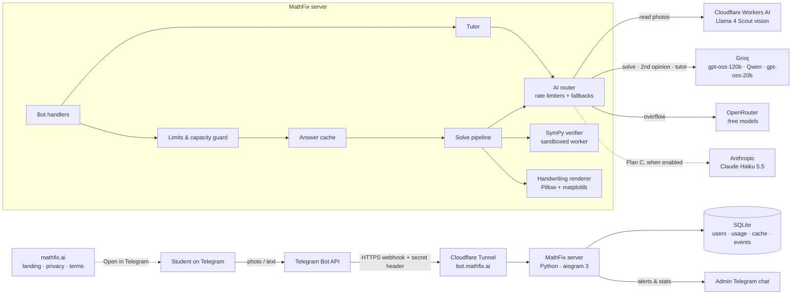
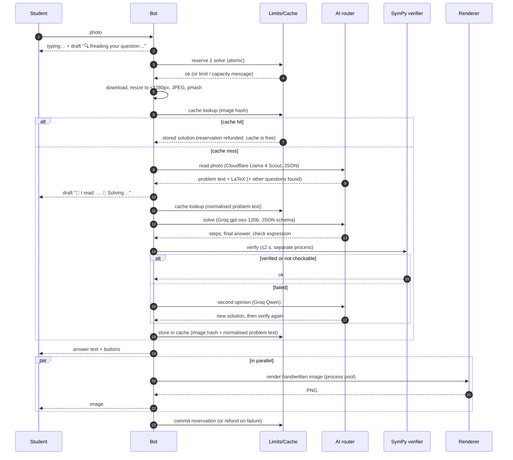

# 02 · Architecture

## Design principles
1. **AI only where it's needed.** Reading the problem, explaining it and tutoring use AI. Checking answers,
   drawing images, caching and limits are plain code: free, instant and deterministic.
2. **One service, many clients.** The solving engine is a core library with an internal API. Telegram is just the
   first client, and the web and mobile apps later call the same API ([09](09-roadmap-apps.md)).
3. **Provider-agnostic.** Every model name lives in `config/models.yaml`. Changing a model or provider is a
   config change, not a code change.
4. **Always-on and simple.** One small Linux server, one Python process, one SQLite file. That's enough for
   thousands of users. Scale out later if needed.

---

## System diagram



---

## Solve pipeline (sequence)



---

## Tech stack

| Layer | Choice | Why |
|---|---|---|
| Language | **Python 3.12** | SymPy, Pillow and matplotlib are Python, so everything stays in one language |
| Telegram framework | **aiogram 3** (async, webhook mode via aiohttp) | Fast, fully async, good FSM and inline-keyboard support |
| AI SDKs | `openai` client pointed at Groq / Cloudflare Workers AI / OpenRouter (all OpenAI-compatible) · `anthropic` SDK only when Plan C is switched on | One wrapper covers all of Plan A |
| HTTP | One shared async client per provider, with keep-alive | Saves ~100–300 ms of TLS setup on every call |
| Validation | `pydantic` v2 | Validates the model's JSON output; malformed output is rejected and retried, never sent to users |
| Maths engine | **SymPy** + mpmath | Exact answer checking and the instant "quick math" path |
| Images | **Pillow** + **matplotlib mathtext** + a free handwriting font (Kalam / Caveat / Patrick Hand, SIL Open Font License) | $0, ~0.3 s, correct maths |
| Image hashing | `imagehash` (perceptual hash) | Same photo sent again → cache hit |
| Database | **SQLite (WAL mode)** via `aiosqlite` | No server, no cost, more than enough for launch. Move to Postgres when there are several servers |
| Process | `systemd` service (or Docker) | Auto-restart, logs to journald |
| Public HTTPS | **Cloudflare Tunnel** (`cloudflared`) | Free TLS, no open ports, no certificate work |
| Landing page | **Cloudflare Pages** (static) | Free; hosts `mathfix.ai`, `/privacy`, `/terms` |

---

## Database schema (SQLite)

```sql
PRAGMA journal_mode = WAL;

CREATE TABLE users (
  user_id        INTEGER PRIMARY KEY,          -- Telegram user id
  username       TEXT,
  first_name     TEXT,
  lang           TEXT DEFAULT 'en',
  tutor_mode     INTEGER DEFAULT 0,
  start_source   TEXT,                          -- deep-link payload, e.g. 'insta', 'ref_ab12'
  is_banned      INTEGER DEFAULT 0,
  bonus_solves   INTEGER DEFAULT 0,             -- referrals etc. (later)
  created_at     TEXT NOT NULL,
  last_seen_at   TEXT NOT NULL
);

-- one row per user per day; atomic UPSERT increments (see 05-daily-limits.md)
CREATE TABLE usage_daily (
  user_id        INTEGER NOT NULL,
  day            TEXT    NOT NULL,              -- 'YYYY-MM-DD' in LIMITS_RESET_TZ
  solves_used    INTEGER DEFAULT 0,
  tutor_used     INTEGER DEFAULT 0,
  solves_reserved INTEGER DEFAULT 0,
  PRIMARY KEY (user_id, day)
);

-- global free-tier budget per provider/model per day
CREATE TABLE provider_usage (
  day            TEXT NOT NULL,
  provider       TEXT NOT NULL,                 -- 'groq' | 'cloudflare' | 'openrouter' | 'anthropic'
  model          TEXT NOT NULL,
  requests       INTEGER DEFAULT 0,
  tokens_in      INTEGER DEFAULT 0,
  tokens_out     INTEGER DEFAULT 0,
  errors_429     INTEGER DEFAULT 0,
  errors_other   INTEGER DEFAULT 0,
  PRIMARY KEY (day, provider, model)
);

CREATE TABLE solutions (
  id             INTEGER PRIMARY KEY,
  problem_key    TEXT NOT NULL,                 -- sha256 of normalised problem text
  problem_text   TEXT NOT NULL,
  problem_latex  TEXT,
  topic          TEXT,
  difficulty     INTEGER,
  solution_json  TEXT NOT NULL,                 -- validated pydantic model
  verified       TEXT NOT NULL,                 -- 'verified' | 'unchecked' | 'failed'
  model_used     TEXT NOT NULL,
  latency_ms     INTEGER,
  wrong_reports  INTEGER DEFAULT 0,
  created_at     TEXT NOT NULL
);
CREATE INDEX idx_solutions_key ON solutions(problem_key);

-- maps an image perceptual hash → solution (photos are NOT stored)
CREATE TABLE image_cache (
  phash          TEXT PRIMARY KEY,
  solution_id    INTEGER NOT NULL REFERENCES solutions(id),
  created_at     TEXT NOT NULL
);

-- tutor context: last few turns per user (trimmed to 6)
CREATE TABLE tutor_turns (
  id             INTEGER PRIMARY KEY,
  user_id        INTEGER NOT NULL,
  solution_id    INTEGER,
  role           TEXT NOT NULL,                 -- 'user' | 'assistant'
  text           TEXT NOT NULL,
  created_at     TEXT NOT NULL
);

CREATE TABLE events (                            -- lightweight analytics
  id             INTEGER PRIMARY KEY,
  user_id        INTEGER,
  name           TEXT NOT NULL,                 -- solve_requested, solve_done, cache_hit, limit_hit,
                                                -- capacity_hit, tutor_msg, wrong_report, feedback
  props_json     TEXT,
  created_at     TEXT NOT NULL
);
```

**Cache rule:** a solution with `wrong_reports ≥ 2`, or one that failed verification, is never served from cache.

---

## Folder layout (code to be written on Saturday)

```
mathfix/
├── main.py                    # starts aiohttp app: webhook + /health
├── config/
│   ├── models.yaml            # model routing (see below)
│   └── limits.yaml            # daily limits, capacity guard thresholds
├── bot/
│   ├── handlers/              # start, photo, text, tutor, usage, admin, callbacks
│   ├── keyboards.py
│   └── texts.py               # every user-facing message in one place (easy to translate)
├── core/
│   ├── pipeline.py            # the solve pipeline above
│   ├── cache.py
│   ├── limits.py              # reserve / commit / refund + capacity guard
│   └── schemas.py             # pydantic: Solution, Step, Check
├── ai/
│   ├── router.py              # picks provider per step, fallbacks, timeouts
│   ├── ratelimit.py           # token buckets per provider/model (RPM, RPD, TPM, TPD)
│   ├── providers/{openai_compat,anthropic}.py
│   └── prompts/{read,solve,escalate,tutor}.md
├── mathcheck/
│   ├── quick.py               # SymPy instant path for arithmetic / simple equations
│   ├── verify.py              # checks by type (equation, derivative, integral, …)
│   ├── sandbox.py             # process pool + timeouts + input whitelist
│   └── latex_to_text.py       # LaTeX → Unicode for Telegram text
├── render/
│   ├── handwriting.py
│   └── assets/{fonts/,paper.png}
├── db/{schema.sql,repo.py}
├── api/                       # (phase 2) REST API for web/mobile apps
└── tests/
    ├── golden_text.jsonl      # ~60 problems with known answers
    └── golden_photos/         # ~30 real photos + answers.json
```

---

## Model routing config (example)

Model IDs must be checked against your console on Friday night (see [03-ai-models.md](03-ai-models.md#verify-on-friday-night)).

```yaml
# config/models.yaml  (Plan A active, Plan C pre-wired but disabled)
providers:
  groq:       { api_key_env: GROQ_API_KEY,       base_url: https://api.groq.com/openai/v1 }
  cloudflare: { api_key_env: CF_AI_API_TOKEN,    base_url: "https://api.cloudflare.com/client/v4/accounts/${CF_ACCOUNT_ID}/ai/v1" }
  openrouter: { api_key_env: OPENROUTER_API_KEY, base_url: https://openrouter.ai/api/v1 }
  anthropic:  { api_key_env: ANTHROPIC_API_KEY }           # empty key → all anthropic models disabled

# limits = YOUR console numbers × 0.9 safety margin
models:
  cf_llama4_scout:  { provider: cloudflare, id: "@cf/meta/llama-4-scout-17b-16e-instruct", vision: true, neurons_per_day: 9000 }
  cf_oss_120b:      { provider: cloudflare, id: "@cf/openai/gpt-oss-120b", vision: false, neurons_per_day: 9000 }  # shares the same neuron pool
  groq_oss_120b:    { provider: groq, id: openai/gpt-oss-120b, vision: false, rpm: 27, rpd: 900, tpm: 7200, tpd: 180000 }
  groq_qwen:        { provider: groq, id: "<current free Qwen id from console>", vision: false, rpm: 27, rpd: 900, tpm: 7200, tpd: 180000 }
  groq_oss_20b:     { provider: groq, id: openai/gpt-oss-20b,  vision: false, rpm: 27, rpd: 900, tpm: 7200, tpd: 180000 }
  or_free_vision:   { provider: openrouter, id: "<pick a :free vision model>",    vision: true,  rpm: 18, rpd: 45 }
  or_free_text:     { provider: openrouter, id: "<pick a :free reasoning model>", vision: false, rpm: 18, rpd: 45 }
  claude_haiku:     { provider: anthropic, id: claude-haiku-5-5, vision: true, monthly_budget_usd: 30 }   # Plan C

steps:                       # tried in order; a model is skipped if disabled, its budget is nearly used, or it is cooling down after 429
  read_photo: [cf_llama4_scout, or_free_vision, claude_haiku]
  solve:      [groq_oss_120b, groq_qwen, cf_oss_120b, or_free_text, claude_haiku]
  escalate:   [groq_qwen, groq_oss_120b]
  tutor:      [groq_oss_20b, cf_oss_120b, or_free_text]

# Plan C switch: put claude_haiku FIRST in read_photo, and add a combined step
#   solve_photo_onecall: [claude_haiku]   → read + solve in one call
timeouts_s: { read_photo: 12, solve: 15, escalate: 20, tutor: 8 }
```

---

## Internal API (used by Telegram now, apps later)

The bot handlers call these functions directly. In phase 2 the same functions are exposed over HTTPS at
`api.mathfix.ai` for the apps.

| Endpoint (phase 2) | Function | Input | Output |
|---|---|---|---|
| `POST /v1/solve` | `pipeline.solve()` | image (multipart) or `{text}` + `user_id` + `lang` | `Solution` JSON + `image_url` |
| `POST /v1/tutor` | `tutor.reply()` | `{solution_id, message, action: hint\|next\|why\|simpler}` | `{reply}` |
| `GET /v1/usage` | `limits.status()` | `user_id` | `{solves_left, tutor_left, resets_at}` |
| `POST /v1/feedback` | `feedback.add()` | `{solution_id, type: wrong\|good, text}` | `204` |

---

## Security checklist
- Webhook validates Telegram's `X-Telegram-Bot-Api-Secret-Token` header. Requests without it are dropped.
- API keys only in `.env` on the server (never in git). Add `.env` to `.gitignore` before the first commit.
- **SymPy never parses untrusted text directly in the main process.** `parse_expr` uses Python `eval`. Inputs are
  whitelisted (digits, letters, `+-*/^()=.,` and known function names; no `_`, no `lambda`, max 300 chars) and run in a
  separate worker process with a 2-second timeout. See [03-ai-models.md](03-ai-models.md#answer-verification-with-sympy).
- Input limits: text ≤ 2,000 characters; image ≤ 10 MB; PDFs and videos are rejected at launch.
- The AI only fills a JSON schema. The bot never runs actions chosen by the AI, so a photo containing "ignore your
  instructions…" can at worst produce a wrong explanation, which verification and reports catch.
- Photos are deleted from memory right after solving. Only the perceptual hash and the extracted problem text
  are stored.
