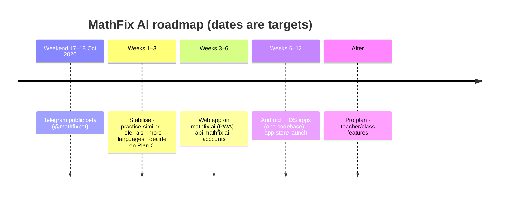

# 09 · Roadmap: from Telegram bot to apps

The Telegram bot is the fastest way to reach students: no app install, no login, instant photos. The apps reuse the
**same backend**, because the solve pipeline is already a library with an internal API
([02](02-architecture.md#internal-api-used-by-telegram-now-apps-later)).

---

## Phase 1.1: after launch (weeks 1–3)
- Fix whatever the beta shows (top wrong-answer topics, slowest paths).
- **Practice similar**: 3 new problems like the one just solved, with SymPy-verified answers.
- **Referrals**: `t.me/mathfixbot?start=ref_<code>` gives +2 solves/day per friend who solves their first problem (max +10).
- More explanation languages, each tested on 20 problems first.
- Raise daily limits as capacity grows (one-time $10 OpenRouter top-up → 10 solves/day; Plan C → 10–15 solves/day).
- Decide the paid trigger for Plan C ([04](04-speed-and-cost.md#paid-upgrade-path)).

## Phase 2: web app (weeks 3–6)
| Item | Plan |
|---|---|
| Where | `mathfix.ai/app` as a **PWA**: works in any phone browser and can be "installed" to the home screen. No app store needed |
| Frontend | React + Vite (static, hosted free on Cloudflare Pages) |
| Backend | `api.mathfix.ai`: the same Python service, adding REST endpoints `POST /v1/solve`, `POST /v1/tutor`, `GET /v1/usage`, `POST /v1/feedback` |
| Login | Telegram Login Widget (so the same daily limits apply across bot and web) + email magic link. Store accounts in our DB; link Telegram id ↔ account |
| Database | Move SQLite → **Postgres** when the API runs on more than one server |
| Limits | Per account (shared across bot, web and apps) + per device/IP burst limits for anonymous use |
| New UX | **Crop box** before upload (one question per photo means better accuracy and fewer tokens), solution history, share link |

## Phase 3: Android + iOS (weeks 6–12)
| Item | Plan |
|---|---|
| Tech | **Expo (React Native)**: one codebase for Android and iOS, reusing the web app's API client and components |
| Camera | In-app camera with auto-crop and edge detection; send ≤ 1280 px JPEG |
| Offline | Saved solutions viewable offline |
| Sign-in | Same accounts as the web; if you offer Google sign-in on iOS, Apple generally requires Sign in with Apple too |
| Store requirements | Privacy policy, data-safety / privacy-nutrition forms, age rating. For a student audience, check Google Play's Families policy and Apple's rules for kids' apps ([08](08-privacy-and-safety.md#6-before-the-apps-phase-23-and-before-targeting-younger-children)) |
| Releases | Android first (faster review, cheaper developer account), then iOS |

## Monetisation (only after there's steady usage)
| Channel | How |
|---|---|
| Telegram | **MathFix Pro** paid with **Telegram Stars** (Telegram's in-app currency for digital goods in bots) |
| Web | Card payments (e.g. Stripe) |
| Apps | In-app purchase/subscription (the stores take a 15–30 % commission) |
| What Pro adds | More daily solves, PDF export of handwritten solutions, full history, practice sets, priority speed |
| What stays free | A daily free allowance forever, which is the growth engine |

## What doesn't change across phases
- The rule: **AI reads and explains; code checks answers and draws images.**
- Config-driven models with fallbacks, plus the capacity guard.
- Photos never stored; minimal data; maths-only scope.
